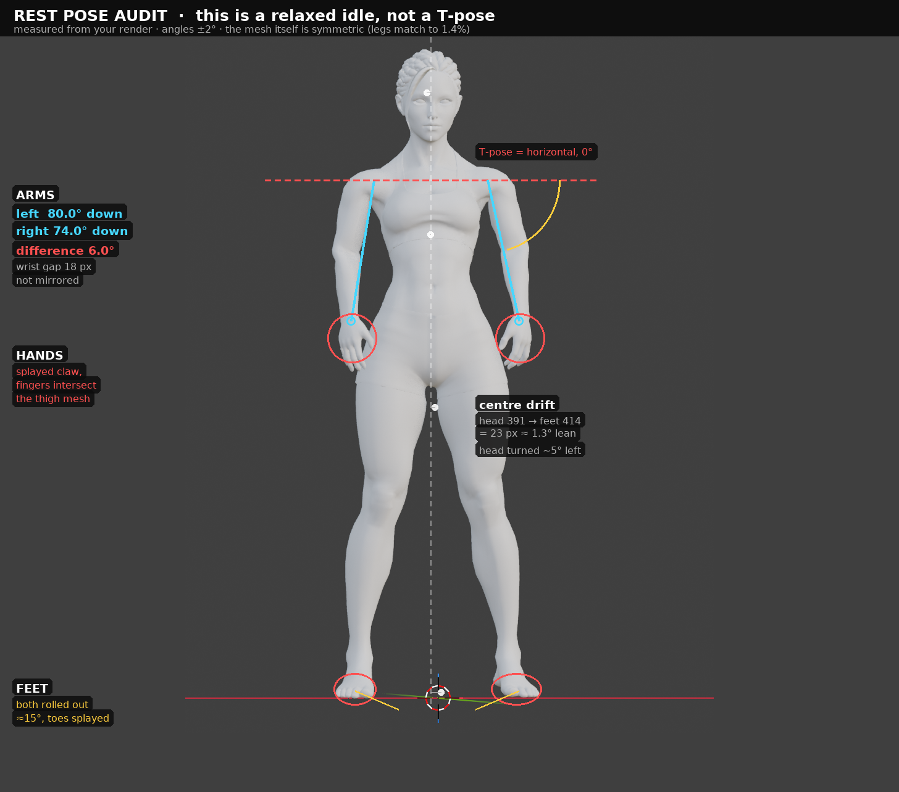

# Your rest pose is not a T-pose — here's what's off, and the fix

You said the character's rest pose is T, but it's standing in a relaxed idle. I measured the
screenshot rather than guessing. Everything below is in pixels from your render, converted to
degrees/percent; treat the angles as ±2°.



---

## 1. What's actually off (ranked by how much it will hurt you)

### 1.1 The arms are ~80° off. This is the big one.

| | measured |
|---|---|
| Left arm | **80.0° below horizontal** |
| Right arm | **74.0° below horizontal** |
| T-pose target | **0° below horizontal** |

They're hanging at the sides. That's not a rest pose, that's an idle. And they're **not even
mirrored** — 80° vs 74°, a 6° difference, with the wrists 129 px and 147 px out from the body
centre line (18 px apart, ~5% of the arm span). A rest pose is dead symmetric; this is a posed
figure.

### 1.2 The hands are in a claw

The fingers are splayed with visible gaps between them and curled at the middle joint, thumb
forward. That's a "relaxed hand" pose asset, not a rest hand — and on both hands the fingers
overlap the thigh silhouette, so **the hand mesh is intersecting the leg**. You can see it in the
crop: the fingertips disappear into the hip/thigh edge.

### 1.3 The feet are rolled out

Both feet are externally rotated about **15°** with the toes splayed and the arches facing the
camera. The two toe boxes aren't the same length either (the left is ~9 px longer). In a rest pose
the feet point forward and lie flat.

### 1.4 The stance isn't neutral — it's weighted onto one leg

Tracing the body's centre line from top to bottom:

| landmark | centre (px) |
|---|---|
| head | 391 |
| shoulders / torso | 397 |
| hips | 404 |
| feet | 414 |

That's a **23 px drift from head to feet over a 1050 px tall character ≈ 1.3° of lean**, plus the
head is turned ~5° to her left. Small numbers, but this is exactly the "something is off and I
can't name it" feeling: the figure is standing *casually*, weight on one hip, not *neutrally*.
Torso silhouette is symmetric (mirror IoU 0.90) — it's the pose, not the model.

### 1.5 The one thing that is definitely NOT wrong

The mesh itself is proportional and symmetric: legs match to within 1.4%, the head is 7.8 heads
tall, the torso silhouette mirrors at IoU 0.90. **Don't touch the model. This is a pose problem.**

---

## 2. Which of these is it? (60-second test)

Three causes produce exactly this picture. The test tells you which in one command:

| # | Cause | Test result |
|---|---|---|
| **A** | A pose / action / pose-asset is left applied (most common) | `--zero --apply` **snaps to T** → cause A or B |
| **B** | FBX/scene import stored the *current* pose as the rest pose; the T-pose only exists in the original bind | same as A, and the skeleton's rest channels read 0 |
| **C** | The skeleton's rest pose was never a T (A-pose rig, or a "relaxed base" mesh), and the T you remember is from another version | `--zero --apply` changes nothing → cause C, use `--tpose --apply` |

```bash
# inside Maya (script editor) or Blender (Python console), with the rig selected
python3 fix_rest_pose.py --audit                 # see your own numbers, changes nothing
python3 fix_rest_pose.py --zero --apply          # cause A/B test
python3 fix_rest_pose.py --tpose --apply         # cause C, or after a failed --zero
```

In Maya you can also do it by hand in two clicks: select the skinned mesh → **Skin ▸ Go to Bind
Pose**. If the character snaps to T, it was cause A/B.
In Blender: Pose Mode → **Alt+R** (or Pose ▸ Clear Transform ▸ All). If it snaps to T, same answer.

---

## 3. The fix

### 3.1 Maya

1. Select all joints in the hierarchy.
2. Channel Box → set **Rotate X/Y/Z to 0**. (Equivalent: `Skin ▸ Go to Bind Pose` on the mesh.)
3. Hands: zero the finger joints too — they're still curled after step 2 if a pose asset wrote
   them. `Skeleton ▸ Assume Preferred Angle` is a fast way to snap fingers back.
4. Clavicles: check they're level; a 5° clavicle lift is what makes shoulders read as "shrugged".
5. If the skeleton's rest is *not* T (cause C): fix the pose by hand or with
   `--tpose --apply`, then **`Skin ▸ Bind Skin` again** (or
   `dagPose -save -bindPose` on the root) so the new pose becomes the bind pose. Rebinding changes
   the skin cluster's bindPreMatrix — that's the part people skip and then wonder why the mesh
   explodes.
6. Re-audit: `python3 fix_rest_pose.py --audit`. Target output is all zeros / "symmetric and
   axis-aligned".

### 3.2 Blender

1. Pose Mode → **A** (select all) → **Alt+R** to clear rotation.
2. Open the NLA editor and delete/mute any strips — a muted action still evaluates if
   `Show Active Action` is on. Also check the Action editor for a leftover action.
3. If the *rest* pose isn't T (cause C): pose it into T by hand, then
   **Pose ▸ Apply ▸ Apply Pose as Rest Pose**. This is Blender's equivalent of rebinding; do it
   *before* you skin anything, or you'll have to re-parent with automatic weights.
4. Re-audit as above.

### 3.3 The order that matters

```
audit → zero → (still not T? → tpose) → re-audit → bake as bind pose → re-audit
```

Don't polish fingers or feet before the arms are right: every one of those corrections is
relative to the arms, and you'll redo them all.

---

## 4. Why this specific error is expensive for your Taekwondo sequence

This isn't cosmetic. It lands directly on the 10-minute script:

1. **Every clip inherits the offset.** Kimodo exports BVH with either its dataset rest pose or a
   standard T (`--bvh_standard_tpose`). Retargeting maps *source rest → target rest*. If the
   target's rest is silently this idle, the constant 80° shoulder difference is absorbed into the
   rotation curves, and every punch, block and kick in all 66 segments comes out wrong in the
   same way — while looking "almost right" in the retarget preview.
2. **The armpits and shoulders will tear.** Skin offsets were computed against a T-pose. Driving
   them from an 80°-adducted rest squeezes the deltoid and collapses the armpit — the exact
   artefact you can already see in the screenshot as the tight armpit crease and the seam running
   across the deltoid.
3. **Feet rolled 15° out = every kick lands sideways.** Kimodo's foot contact and foot-skate
   post-processing assume a neutral foot. A rolled-out rest rotates every foot placement by 15°,
   and the front-kick, side-kick and back-kick strikes in B4 all end up aiming off-axis.
4. **The lean breaks poomsae lines.** Taegeuk Il Jang is judged on the straightness of the T
   walk. A 1.3° lean in the rest pose shows up as drift across the 6:10–8:00 block, and you'll
   be fighting it with root corrections for the whole form.

Fix the rest pose *before* you generate anything. It's a two-minute job now and a two-day job
after 18,000 frames are retargeted onto it.

---

## 5. `fix_rest_pose.py`

Lives next to this file. Dual backend (Maya / Blender), no dependencies.

| Flag | What it does |
|---|---|
| `--audit` | prints every measurement above, from *your* rig |
| `--zero --apply` | zero every pose rotation → skeleton's own rest pose |
| `--tpose --apply` | aim arms horizontal, legs vertical, feet forward and flat, spine upright |
| `--apose 45 --apply` | same, arms 45° below horizontal (better than T for most skinning) |
| `--bake-rest --apply` | save the result as the bind/rest pose |
| `--roll JOINT DEG` | twist a limb about its own axis — the one thing bone directions can't tell us |
| `--selftest` | runs the whole thing on a synthetic rig in a bad pose; no DCC needed |

```bash
python3 fix_rest_pose.py --selftest     # -> SELFTEST PASSED
```

It resolves joints by name (Mixamo, HumanIK, Advanced Skeleton, Rigify, SOMA, generic `.L/.R`
suffixes) and refuses to guess when it can't find a shoulder pair.

**Known limits, stated plainly:**

* Twist (palm direction, knee rotation, foot roll angle) is not observable from bone *directions*.
  The fixer straightens the limbs; if a palm ends up facing the wrong way, fix it with
  `--roll hand_L -90` or by hand. Expect to touch the hands.
* It assumes the character stands upright and faces roughly along the world forward axis. A rig
  authored lying down needs a manual pass first.
* `--zero` assumes the skeleton's rest *is* a T. That's the assumption your setup makes; if it's
  false, you have cause C.
